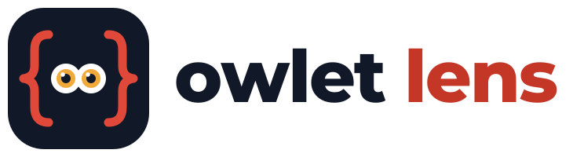
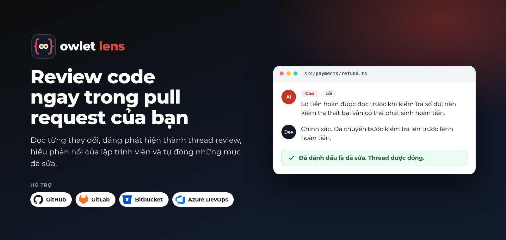
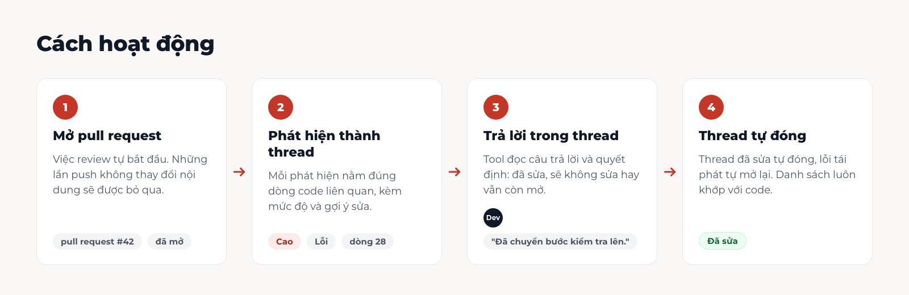
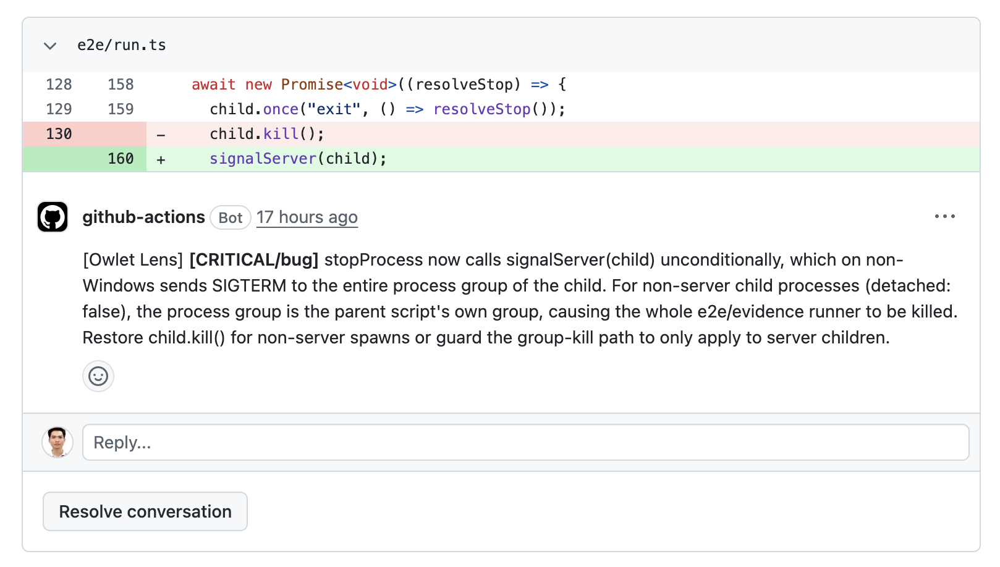
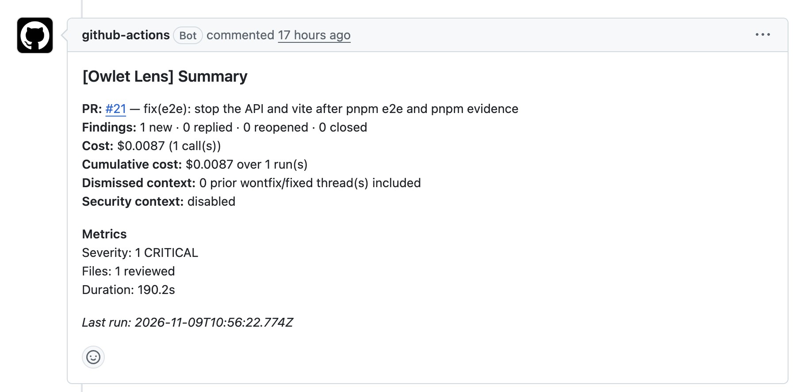

<h1 align="center">
  <picture>
    <source media="(prefers-color-scheme: dark)" srcset="docs/assets/logo/owlet-lens-dark.svg">
    
  </picture>
</h1>

[English](./README.md) · **Tiếng Việt**

<p align="center">
  
</p>

[](https://github.com/openwt-vn/owlet-lens/actions/workflows/ci.yml)


<p align="center">
  <a href="#bắt-đầu-nhanh-github">Bắt đầu nhanh</a> ·
  <a href="#các-nền-tảng-khác">GitLab · Bitbucket · Azure DevOps</a> ·
  <a href="#chọn-nhà-cung-cấp-llm">Nhà cung cấp LLM</a> ·
  <a href="#quyền-riêng-tư-và-bảo-mật">Quyền riêng tư</a> ·
  <a href="#tài-liệu">Tài liệu</a> ·
  <a href="#câu-hỏi-thường-gặp">Câu hỏi thường gặp</a>
</p>

Công cụ review code bằng AI cho pull request. Tool đăng các phát hiện thành thread review ngay trên dòng code, đọc phản hồi của lập trình viên, và đóng những thread đã được sửa hoặc đã bị từ chối. Chạy trên GitHub (trang này), cùng Bitbucket Cloud (chỉ bản Cloud), GitLab ([cài đặt](./docs/gitlab-setup.md)) và Azure DevOps ([cài đặt](./docs/usage.md#review-provider-github-bitbucket-gitlab-or-azure-devops)).

## Vì sao dùng

- **Biết trả lời.** Đọc từng phản hồi của lập trình viên và quyết định: đã sửa, sẽ không sửa, hay vẫn còn mở.
- **Tự dọn dẹp.** Thread đã sửa tự đóng, lỗi tái phát tự mở lại, nên danh sách thread luôn khớp với code.
- **Biết học.** Những phát hiện mà đội ngũ liên tục từ chối được đề xuất thành quy tắc chuẩn code, trong một pull request do người duyệt.
- **Chạy ở nơi bạn đang làm việc.** Bốn nền tảng, nhiều nhà cung cấp AI (kể cả mô hình chạy cục bộ), và không có gì để tự vận hành: không database, không server.

## Cách hoạt động



1. **Review** (khi mở hoặc push PR): gửi diff cho LLM, đăng các phát hiện mới, trả lời ở những thread còn mở, mở lại thread khi lỗi tái phát, đóng thread đã sửa, và luôn cập nhật một comment tổng hợp.
2. **Reply** (khi lập trình viên trả lời trong thread review): LLM đọc cuộc trao đổi và quyết định `fixed`, `wontfix` hay `active`, rồi cập nhật thread.
3. **Learn** (theo lịch, tùy chọn): tìm những phát hiện mà đội ngũ liên tục từ chối và đề xuất quy tắc chuẩn code mới qua một pull request. Luôn có người duyệt; không có gì tự merge.

Không có database: trạng thái review nằm trong các marker ẩn bên trong comment, còn các quy tắc đã học nằm trong một file của repo.

## Bắt đầu nhanh (GitHub)

**1. Thêm một secret.** Repo → Settings → Secrets and variables → Actions → `ANTHROPIC_API_KEY` (nhà cung cấp khác: [bên dưới](#chọn-nhà-cung-cấp-llm)).

**2. Thêm file `.github/workflows/ai-review.yml`:**

```yaml
name: Owlet Lens
on:
  pull_request:
    types: [opened, synchronize, reopened]
  pull_request_review_comment:
    types: [created]

jobs:
  review:
    if: github.event_name == 'pull_request'
    runs-on: ubuntu-latest   # hoặc self-hosted
    permissions:
      contents: read
      pull-requests: write
    steps:
      - uses: actions/checkout@v4
        with: { fetch-depth: 0 }   # review cần toàn bộ lịch sử để so sánh diff
      - uses: openwt-vn/owlet-lens@v1
        with:
          anthropic-api-key: ${{ secrets.ANTHROPIC_API_KEY }}
          subcommand: review

  reply:
    if: github.event_name == 'pull_request_review_comment' && github.event.comment.user.type != 'Bot'
    runs-on: ubuntu-latest   # hoặc self-hosted
    permissions:
      contents: read
      pull-requests: write
    steps:
      - uses: actions/checkout@v4
      - uses: openwt-vn/owlet-lens@v1
        with:
          anthropic-api-key: ${{ secrets.ANTHROPIC_API_KEY }}
          subcommand: reply
```

Các câu trả lời được đọc từ comment **bên trong thread review** (`pull_request_review_comment`), không phải từ tab conversation của PR.

> [!TIP]
> Để đọc cả câu trả lời ở tab conversation, thêm `issue_comment: { types: [created] }` vào `on:` và thay điều kiện `if:` của job reply bằng:
>
> ```yaml
> if: >-
>   (github.event_name == 'pull_request_review_comment' && github.event.comment.user.type != 'Bot')
>   || (github.event_name == 'issue_comment' && github.event.issue.pull_request != null)
> ```
>
> [Workflow](./.github/workflows/ai-review.yml) của chính repo này thêm một bước kiểm tra rằng người comment là thành viên của repo.

**3. Mở một pull request.** Các phát hiện xuất hiện thành thread review trong một đến hai phút. Hãy trả lời trong thread để trao đổi.

> [!NOTE]
> Mọi input và output của Action, các mã thoát và cách ghim phiên bản nằm trong [tài liệu sử dụng](./docs/usage.md) (tiếng Anh).

<details>
<summary><b>Ngắn hơn: gọi workflow dùng lại</b></summary>

Giữ khối `on:` ở bước 2 và thay hai job bằng một lời gọi. Nó chạy cả job review lẫn job reply:

```yaml
jobs:
  ai-review:
    uses: openwt-vn/owlet-lens/.github/workflows/ai-review-reusable.yml@v1
    with:
      runner: '["ubuntu-latest"]'   # bắt buộc; '["self-hosted"]' cho runner của bạn
    secrets: inherit
```

`runner` là một danh sách JSON trong chuỗi vì workflow truyền nó vào `runs-on`. Nó đọc một secret khóa LLM (`ANTHROPIC_API_KEY`, `DEEPSEEK_API_KEY`, `GEMINI_API_KEY` hoặc `MODELSTACK_API_KEY`) và secret tùy chọn `AI_REVIEW_RESOLVE_TOKEN`; danh sách nằm ở đầu file [`ai-review-reusable.yml`](./.github/workflows/ai-review-reusable.yml).
</details>

## Các nền tảng khác

GitHub Action bọc một công cụ dòng lệnh có hai lệnh, `review` và `reply`. Trên các nền tảng khác, một pipeline clone repo này và chạy hai lệnh đó bằng Node; các template dưới đây làm việc đó. Mỗi nền tảng cần token riêng của nó cùng một khóa LLM, và công cụ tự nhận ra nền tảng từ môi trường CI.

<details>
<summary><b>GitLab</b> (GitLab.com và tự host)</summary>

Review và reply chạy trên pipeline của merge request; learn chạy theo lịch pipeline. Lấy template theo một trong hai cách: chép [`examples/gitlab-ci.yml`](./examples/gitlab-ci.yml) vào dự án của bạn thành `.gitlab-ci.yml`, hoặc include nó từ một bản mirror của repo này trên GitLab của bạn (`include:` chỉ đọc được project trên cùng GitLab, nên hãy đẩy một bản sao của repo này lên đó trước):

```yaml
include:
  - project: '<group>/owlet-lens'
    ref: main
    file: '/examples/gitlab-ci.yml'
```

Dù theo cách nào, sau đó đặt `AI_REVIEW_REPO` (URL clone của bản mirror Owlet Lens của bạn) và `AI_REVIEW_REF` (tag để ghim) trong template, thêm biến CI/CD `ANTHROPIC_API_KEY` (hoặc khóa LLM khác) và `GITLAB_TOKEN` (scope `api`), rồi chép [`examples/ai-review.gitlab.yaml`](./examples/ai-review.gitlab.yaml) thành `ai-review.config.yaml`. Các bước đầy đủ: [cài đặt GitLab](./docs/gitlab-setup.md).
</details>

<details>
<summary><b>Bitbucket Cloud</b></summary>

Thêm một step trong pipeline pull request chạy `reply` rồi `review` với `--provider=bitbucket`. Reply chạy trước để review thấy các câu trả lời mới nhất của lập trình viên. File [`bitbucket-pipelines.yml`](./bitbucket-pipelines.yml) của repo này là một template có sẵn các dòng cài đặt và chạy; nó cần hai biến repository được bảo mật: `AI_REVIEW_TOKEN` (access token có `pullrequest:write`) và khóa LLM được đặt tên trong config của bạn (`DEEPSEEK_API_KEY` trong template). Bitbucket Pipelines không có trigger khi có comment, nên câu trả lời của lập trình viên được đọc ở lần push kế tiếp. Không hỗ trợ Bitbucket Server và Data Center. Các biến môi trường: [review provider](./docs/usage.md#review-provider-github-bitbucket-gitlab-or-azure-devops).
</details>

<details>
<summary><b>Azure DevOps</b></summary>

Chưa có template pipeline. Trong một build kiểm tra pull request, chạy hai lệnh như template Bitbucket với `--provider=azure-devops`, với một personal access token (PAT) trong `AZURE_DEVOPS_TOKEN` hoặc `System.AccessToken` của pipeline, cùng khóa LLM được đặt tên trong config của bạn (ví dụ `ANTHROPIC_API_KEY`). Nền tảng được tự nhận ra trên Azure Pipelines. Các biến bắt buộc và các khóa cấu hình `azure.*`: [review provider](./docs/usage.md#review-provider-github-bitbucket-gitlab-or-azure-devops).
</details>


## Chọn nhà cung cấp LLM

Review và reply mỗi bên chọn một nhà cung cấp, nên bạn có thể dùng mô hình mạnh hơn cho review và mô hình rẻ hơn cho reply.

| Nhà cung cấp | Input của Action | Ghi chú |
|---|---|---|
| Anthropic (mặc định) | `anthropic-api-key` | Mặc định: review `claude-opus-4-7`, reply `claude-haiku-4-5-20251001` |
| Gemini | `gemini-api-key` | Đặt `review-provider: gemini` |
| DeepSeek | `deepseek-api-key` | Đặt `review-provider: deepseek` |
| ModelStack (cổng tương thích OpenAI) | `modelstack-api-key` | Không có bảng giá sẵn: chi phí hiển thị `$0` trừ khi bạn thêm khối `pricing:` |
| Bất kỳ endpoint tương thích OpenAI nào, kể cả mô hình cục bộ | khóa cấu hình `review.apiBaseUrl` | Với mô hình cục bộ, key có thể để trống |

Để dùng nhà cung cấp khác mặc định, thay `anthropic-api-key` ở **cả hai** job và ghi rõ tên model:

```yaml
        with:
          gemini-api-key: ${{ secrets.GEMINI_API_KEY }}
          review-provider: gemini
          reply-provider: gemini
          review-model: <một model mà nhà cung cấp của bạn có>
          reply-model: <một model mà nhà cung cấp của bạn có>
          subcommand: review   # hoặc reply
```

Tên model mà nhà cung cấp không chấp nhận sẽ làm mọi lần gọi đều lỗi. Model dự phòng, bảng giá và mọi khóa khác nằm trong [tài liệu cấu hình](./docs/config.md#llm-providers).

## Quyền riêng tư và bảo mật

Tool gửi code của bạn tới nhà cung cấp LLM mà bạn chọn, nên hãy cân nhắc kỹ.

- **Được gửi:** diff của pull request, các file mà diff import, các file bạn liệt kê trong `review.contextPaths` và `review.codingStandardsPath`, và các câu trả lời của lập trình viên mà tool cần đánh giá.
- **Được lọc:** các chuỗi có hình dạng của secret (khóa API, token, mật khẩu, chuỗi kết nối, khóa riêng) được thay bằng `[REDACTED]` trong diff, file được import, câu trả lời và dữ liệu đầu vào của learn trước khi gửi. Đây là so khớp theo mẫu, không phải bảo đảm: một secret có hình dạng lạ vẫn lọt qua.
- **Không được lọc:** nội dung của `contextPaths` và các file chuẩn code được gửi nguyên văn. Hãy giữ secret ra khỏi các file này.
- **Model dự phòng** có thể đưa code của bạn tới một nhà cung cấp khác. Hãy xem xét mọi model bạn liệt kê.

Chi tiết theo từng nhà cung cấp: [chính sách dữ liệu LLM](./docs/llm-data-policy.md). Để báo một lỗ hổng bảo mật, xem [SECURITY.md](./SECURITY.md) (bằng tiếng Anh).

## Tài liệu

Các tài liệu dưới đây bằng tiếng Anh.

| Chủ đề | Đọc |
|---|---|
| Input và output của Action, mã thoát, chế độ strict (làm CI thất bại khi có phát hiện nghiêm trọng), quyền của token, ghim phiên bản | [docs/usage.md](./docs/usage.md) |
| Mọi khóa trong `ai-review.config.yaml` | [docs/config.md](./docs/config.md) |
| Dữ liệu gửi tới từng nhà cung cấp LLM | [docs/llm-data-policy.md](./docs/llm-data-policy.md) |
| Cài đặt GitLab | [docs/gitlab-setup.md](./docs/gitlab-setup.md) |
| Cổng team lead (tùy chọn): giữ AI lại trên một pull request tới khi một lead được chỉ định bật nó, cho các nhóm muốn một người quyết định PR nào được review | [GitHub](./docs/tl-gate-github-setup.md) · [GitLab](./docs/tl-gate-gitlab-setup.md) · [Bitbucket](./docs/tl-gate-bitbucket-setup.md) · [Azure DevOps](./docs/tl-gate-azure-devops-setup.md) |
| Cấu hình và pipeline mẫu | [examples/](./examples/) |
| Chạy tại máy, sơ đồ code, phát hành | [CONTRIBUTING.md](./CONTRIBUTING.md) |
| Mục lục đầy đủ, gồm các quyết định kiến trúc | [docs/README.md](./docs/README.md) |

## So sánh với các công cụ tương tự

Dựa trên tài liệu công khai của từng dự án, kiểm tra ngày 10/11/2026.

| | Owlet Lens | [CodeRabbit](https://docs.coderabbit.ai/platforms/overview.md) | [PR-Agent](https://github.com/qodo-ai/pr-agent) | [Copilot code review](https://docs.github.com/en/copilot/concepts/agents/code-review) |
|---|---|---|---|---|
| Giấy phép | Apache-2.0 | Dịch vụ lưu trữ sẵn | MIT | Một phần của GitHub Copilot |
| Chạy ở | CI của bạn | Cloud của họ; tự triển khai cho Enterprise | CLI, Action, Docker | GitHub |
| Nền tảng | GitHub, GitLab, Bitbucket Cloud, Azure DevOps | GitHub, GitLab, Bitbucket, Azure DevOps | GitHub, GitLab, Bitbucket, Azure DevOps, Gitea | GitHub, Azure DevOps (preview) |
| Dùng mô hình AI riêng | ✅ Kể cả mô hình cục bộ | ❌ | ✅ Kể cả mô hình cục bộ | ❌ |
| Chi phí | Chỉ phần dùng LLM | Gói theo lập trình viên | Chỉ phần dùng LLM | Gói Copilot |
| Đọc phản hồi, đóng thread đã sửa | ✅ | ❌ | ❌ | ❌ |
| Học quy tắc từ phát hiện bị từ chối | ✅ | ❌ | ❌ | ❌ |

## Một lần chạy trông như thế nào

**Một phát hiện trên pull request thật.** Tool đăng mỗi phát hiện thành một thread review ngay trên dòng code liên quan, kèm mức độ nghiêm trọng và loại lỗi. Lập trình viên có thể trả lời trong thread hoặc đánh dấu đã giải quyết.



**Comment tổng hợp.** Bot giữ một comment tổng hợp cho mỗi pull request và cập nhật nó sau mỗi lần push: số phát hiện mới, đã trả lời, mở lại hoặc đóng, chi phí của lần chạy, số lượng theo mức độ nghiêm trọng và thời gian chạy.



Nội dung comment của bot hiện bằng tiếng Anh.

## Câu hỏi thường gặp

- **Nó có thay thế review của con người không?** Không. Nó là lượt xem xét đầu tiên, bắt các vấn đề thông thường, để người review dành thời gian cho thiết kế và logic nghiệp vụ. Con người vẫn là người duyệt và merge.

Thêm các câu hỏi về dữ liệu và quyền riêng tư, model chạy cục bộ, chi phí, ngôn ngữ, fork, strict mode: xem [FAQ](./docs/faq.md) (tiếng Anh).

## Tùy chỉnh

Tùy chọn: thêm `ai-review.config.yaml` ở thư mục gốc của repo (model, ngưỡng mức độ, đường dẫn cần bỏ qua, chuẩn code). Hãy bắt đầu từ [file cấu hình mẫu](./examples/ai-review.config.yaml). Mọi khóa đều có trong [tài liệu cấu hình](./docs/config.md).

| Bạn muốn… | Xem ở đâu |
|---|---|
| Làm CI thất bại khi có phát hiện nghiêm trọng (`strict`) | [Tài liệu sử dụng](./docs/usage.md#strict-mode) |
| Cho bot bật nút "Resolved" của GitHub | [Quyền của token](./docs/usage.md#limitations--token-permissions) |
| Mọi input và output của Action, ghim phiên bản | [Tài liệu sử dụng](./docs/usage.md#inputs) |

## Chế độ Team Lead (tùy chọn)

Mặc định công cụ review mọi lần push. Khi bật TL gate, một pull request **không được AI review** cho đến khi một team lead mà bạn chỉ định bấm nút "bật AI" của nền tảng cho PR đó. Sau đó nó review mọi lần push như bình thường. Chế độ này giữ chi phí và độ ồn ở mức thấp ở những repo mà bạn muốn có người quyết định trước.

```yaml
# ai-review.config.yaml, trên nhánh ĐÍCH của pull request
review:
  tlGate:
    enabled: true
    leads: ["12345", "67890"]   # user id dạng số, không dùng username
```

Trên GitHub, nút đó là **Re-run all jobs** trên lần chạy review của PR; không cần sửa workflow. Công tắc và danh sách được đọc từ nhánh đích, nên một pull request không thể tự tắt gate của chính nó. Cách thiết lập theo nền tảng: [GitHub](./docs/tl-gate-github-setup.md) · [GitLab](./docs/tl-gate-gitlab-setup.md) · [Bitbucket](./docs/tl-gate-bitbucket-setup.md) · [Azure DevOps](./docs/tl-gate-azure-devops-setup.md) (tài liệu tiếng Anh). Thiết kế: [ADR-0014](./docs/adr/0014-tl-gate-reads-the-target-branch.md).

## Dòng lệnh (CLI)

Ngoài Action, bạn có thể chạy từ terminal hoặc bất kỳ CI nào. Gói chưa được đưa lên npm: hãy clone repo này rồi chạy:

```bash
npm install                       # Node 20.10 trở lên
GITHUB_TOKEN=... ANTHROPIC_API_KEY=... GITHUB_REPOSITORY=owner/repo GITHUB_PR_NUMBER=42 \
  npm run review -- --dry-run     # in ra những gì sẽ đăng, không đăng gì
```

| Lệnh | Tác dụng |
|---|---|
| `npm run review` | Review một pull request |
| `npm run reply` | Đánh giá phản hồi của developer trong các thread của AI |
| `npm run learn` | Đề xuất rule coding standards từ các phát hiện bị từ chối |
| `npm run init` | Hỏi vài câu và tạo `ai-review.config.yaml` |

Cờ hay dùng: `--dry-run`, `--strict` (exit code 8 khi có phát hiện mức chặn), `--config=<path>`, `--provider=<github|bitbucket|gitlab|azure-devops>`, `--force-review`. Biến môi trường cho các nền tảng khác, các cờ và exit code: [Usage reference](./docs/usage.md) (tiếng Anh).

## Đóng góp

Xem [CONTRIBUTING.md](./CONTRIBUTING.md). Mục lục tài liệu: [docs/README.md](./docs/README.md).

Các tài liệu chi tiết trong thư mục `docs/` hiện chỉ có bằng tiếng Anh.

## Giấy phép

Phát hành theo [Apache License 2.0](./LICENSE). Bản quyền 2026 Open Web Technology Vietnam LLC.

Tên Owlet Lens và logo của dự án không nằm trong phạm vi giấy phép: xem [TRADEMARKS.md](./TRADEMARKS.md) và [NOTICE](./NOTICE).
